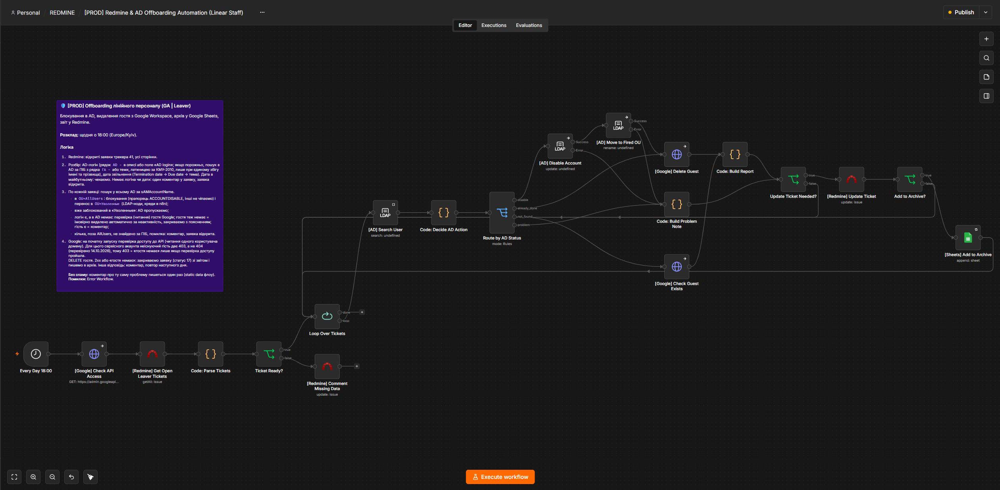
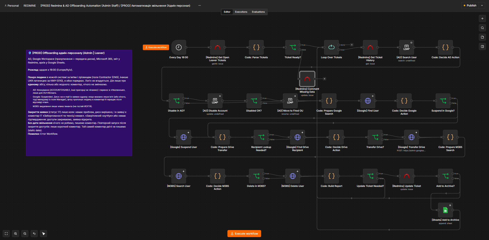
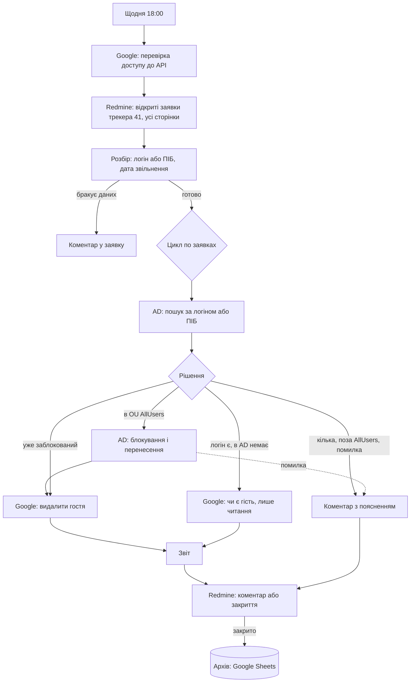
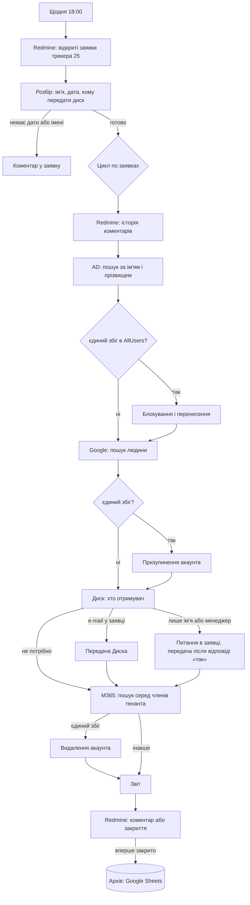

# Staff Offboarding: автоматичне закриття доступів при звільненні

Два флоу n8n, які щодня читають заявки на звільнення з Redmine, знаходять людину в Active Directory,
Google Workspace і Microsoft 365, закривають доступи й пишуть у заявку звіт про те, що саме зроблено.
Якщо чогось бракує або щось неоднозначне, флоу **нічого не змінює**, а залишає в заявці коментар
із трьох частин: що перевірено, який результат, що робити далі.

| | Лінійний персонал | Адмін-персонал |
|---|---|---|
| Флоу | `workflows/linear-offboarding.json` | `workflows/admin-offboarding.json` |
| Трекер Redmine | `GA | Leaver` (id 41) | `Admin | Leaver` (id 25) |
| Хто створює заявки | зовнішня система HR (бот), логін у рядку `AD -` | HR вручну, вільний текст |
| AD | блокування і перенесення в «Уволенные» | те саме |
| Google | видалення гостьового акаунта | призупинення акаунта і **передача Диска** |
| M365 | немає | видалення акаунта |
| Запуск | щодня о 18:00 (Europe/Kyiv) | щодня о 18:00 (Europe/Kyiv) |
| Нод | 21 | 35 |

## Що було не так у попередній версії

Проєкт виріс із двох робочих флоу. Розбір реальних запусків показав:

- **Тиха зупинка.** У заявках, де порожній рядок `AD -`, регулярний вираз «перескакував» на наступний рядок
  і брав за логін номер телефону. Пошук в AD нічого не знаходив, флоу завершувався зі статусом success
  і нікому нічого не казав.
- **Не всі заявки.** Redmine віддавав лише перші 50 із 213 задач, без фільтра за трекером і статусом.
- **Пароль сервісного облікового запису AD був записаний відкритим текстом** у команді `ldapmodify`
  (Execute Command), разом із `LDAPTLS_REQCERT=never` і shell-ін'єкцією через DN.
- **Логін вгадувався** з англійського імені за вісьмома шаблонами, пошук ішов по всьому домену. Ризик:
  однофамілець або вже звільнена людина.
- **Заявка закривалась при неповернутій техніці.** У звіті завжди стояло «Заборгованості по техніці немає»,
  навіть коли IT щойно написав «закріплений ноутбук». Після повторного відкриття флоу прогонявся заново і
  знову закривав заявку.
- **Заявка без дати звільнення** оброблялась одразу, ніби людина звільняється сьогодні.
- **Один не знайдений працівник** обривав обробку решти в цьому запуску.

## Еволюція: v1 → v2

Історія репозиторію зберігає обидві версії. Тег `v1.0` вказує на першу версію (два флоу, завантажені в серпні 2026),
тег `v2.0` на повністю переписану. Вихідні файли v1 лежать у `archive/v1/` (без паролів і внутрішніх адрес).

| | v1 (серпень 2026) | v2 (жовтень 2026) |
|---|---|---|
| Нод: адмін / лінійний | 19 / 10 | 35 / 21 |
| Пошук людини | логін вгадується за вісьмома шаблонами, пошук по всьому домену | ім'я й прізвище в обох порядках, дія лише при єдиному збігу |
| Пароль AD | у команді `ldapmodify` відкритим текстом | немає, вбудовані LDAP-ноди й облікові дані n8n |
| Помилки | флоу тихо зупиняється або пише «успішно» | коментар у заявку: що перевірено, результат, що робити далі |
| Техніка | у звіті завжди «Заборгованості немає» | заявка закривається лише за підтвердженням IT |
| Повторний запуск | усе прогоняється знову | короткий коментар, дії не повторюються |
| Тести | немає | 39 і 28 сценаріїв, сухий прогін, жива перевірка на тестовому співробітнику |

Сама v2 теж пройшла через спрощення: перший переписаний варіант мав 41 і 23 ноди, з багатьма проміжними
Code-нодами. Після перегляду «склейки» вбудовано в сусідні ноди, розгалуження залишено видимими на схемі
(IF, Switch): 35 і 21 нода, логіка й результат ті самі, тести ті самі.

## Скриншоти

**Лінійний персонал** (21 нода): розбір заявок, цикл, пошук і рішення в AD, видалення гостя Google, звіт і оновлення заявки.



**Адмін-персонал** (35 нод): ряди йдуть за етапами: розбір заявок і пошук в AD, блокування й Google, передача Диска, M365, звіт і архів.



## Схеми

### Лінійний персонал



### Адмін-персонал



## Як приймаються рішення

### Пошук людини (обидва флоу)

Логін не вгадується. Людину шукають за ім'ям і прізвищем у кожній системі, в обох порядках
(«Ім'я Прізвище» і «Прізвище Ім'я»): англійське ім'я з заявки, а якщо його немає, українське латиницею
за транслітерацією КМУ 2010 (наприклад, Є → Ye на початку слова, зг → zgh). Дія виконується
**лише при єдиному збігу**; якщо людей кілька або жодного, у заявку пишеться список кандидатів.

Запасний шлях в AD для акаунтів, у яких не заповнені ім'я та прізвище (старі, з префіксом `ms.`):
шаблони логіна `ім'я.прізвище`, `і.прізвище`, `ms.і.прізвище`, `ms.ім'я.прізвище`. Акаунт береться, лише якщо
він один, а ім'я й прізвище в ньому порожні або збігаються. У звіті про це пишеться окремо.

### Лінійний персонал

| Ситуація | Що робить флоу |
|---|---|
| Логін у заявці є, акаунт в `OU=AllUsers` | блокує (лише прапорець `ACCOUNTDISABLE`, решта не чіпається), переносить в «Уволенные», видаляє гостя Google, закриває заявку, пише в архів |
| Логіна немає | шукає в AD за ПІБ з рядка `ГА -` або з теми заявки |
| Уже заблокований в «Уволенные» | пропускає AD, видаляє гостя, закриває |
| Логін є, в AD немає | перевіряє (лише читання), чи є гість Google. Гостя теж немає: закриває заявку з поясненням «імовірно видалено автоматично через неактивність» |
| Кілька акаунтів, поза `AllUsers`, помилка AD | нічого не змінює, коментар з причиною, заявка відкрита |
| Немає дати звільнення | коментар, нічого не робить |
| Дата в майбутньому | чекає |

Особливість Google: для сервісного облікового запису неіснуючий гість дає **403, а не 404**. Тому на початку
кожного запуску флоу перевіряє доступ до API (читання одного користувача); 403 на гостя означає «гостя немає»
лише якщо ця перевірка пройшла.

### Адмін-персонал

- **Диск** передається одразу, якщо в заявці є e-mail отримувача. Якщо вказано лише ім'я («передати - Прізвище Ім'я»)
  або нічого (тоді береться менеджер із поля Manager), флоу знаходить людину в Google й питає в заявці:
  «Передати диск: Ім'я (e-mail)?». Диск передається після відповіді «так» під час наступного запуску.
  Відповіді «не потрібно», «видалити», «не переадресовувати» означають, що передавати нічого.
- **Закриття заявки** (статус 17) лише коли немає проблем, питання з диском вирішене, а в заявці є коментар IT
  «Заборгованості по техніці немає». Якщо написано «закріплений ноутбук» або підтвердження ще немає, доступи
  закриваються, заявка залишається відкритою, а в звіті пояснено, чого бракує.
- **Повторний запуск** після закриття доступів (заявку переоткрили): лише короткий коментар, жодна дія не повторюється.
- **M365:** видаляється лише член тенанта; зовнішні гості (`#EXT#`) не рахуються.
- **Звірка логінів:** якщо логіни в різних системах відрізняються, у звіті стоїть попередження.
- В архів Google Sheets рядок пишеться лише при першому закритті.

### Без спаму

Той самий коментар про ту саму проблему пишеться один раз (стан у static data флоу). Коли проблему виправлено,
флоу сам обробляє заявку під час наступного запуску.

## Безпека

- **У флоу немає паролів і Execute Command.** Блокування й перенесення в AD виконують вбудовані LDAP-ноди
  (Update, Rename), підключення через облікові дані n8n. Пароль із команди `ldapmodify` прибрано.
- Файли в `workflows/` містять лише заглушки облікових даних (`<LDAP_CRED>`, `<REDMINE_CRED>` та інші) та
  `<ARCHIVE_SHEET_ID>`. Справжні підставляє `tools/deploy_*.py` з живої версії флоу.
- Дії виконуються тільки при єдиному однозначному збігу; усе спірне лишається людині.
- Лише читання перед дією: гість Google перевіряється GET-запитом, ніщо не видаляється наосліп.
- Помилки AD, Google, M365 не зупиняють решту заявок і не закривають заявку.
- Репозиторій обезличено: домени замінено на `example.com`, назви облікових записів і проєкту Redmine узагальнено, ідентифікатори трекерів і полів Redmine наведено як приклад. Підставте власні значення.

## Тестування

Реальні люди й системи в тестах не чіпаються.

| Рівень | Що перевіряє | Команда |
|---|---|---|
| Заглушки | вся логіка флоу: копія флоу з Cron замість Webhook і заглушками замість Redmine, AD, Google, M365, Sheets. 39 сценаріїв для лінійного, 28 для адмін | `python tests/run_linear_tests.py --url <n8n> --key-file <ключ> [--workflow workflows/admin-offboarding.json --cases tests/cases_admin.json]` |
| Сухий прогін | справжні читання (Redmine, пошук в AD, Google, M365), усі зміни замінені заглушками | `python tests/dry_run_linear.py`, `python tests/dry_run_admin.py` |
| Тестовий Redmine | заявки вигаданих людей у форматах бойових (`tests/fixtures/test_redmine_tickets.json`, `tools/seed_test_redmine.py`) | `python tests/dry_run_admin.py --redmine-cred <id>` |
| Реальні дії на тестовому працівнику | `tests/live_test_admin.py`: захист пропускає лише одну заявку й лише одне прізвище | `python tests/live_test_admin.py --ticket <id> --surname <прізвище> ...` |

Сценарії генерують `tests/make_cases_linear.py` і `tests/make_cases_admin.py`. Чутливість тестів перевірена: із навмисно неправильними очікуваннями вони падають.

Реальні запуски: лінійний флоу закрив дві заявки з блокуванням в AD і видаленням гостей Google та дві заявки,
де людини вже не було ні в AD, ні в Google; адмін-флоу пройшов повний цикл на тестовому співробітнику
(AD, Google, передача Диска, M365) і при повторному відкритті заявки нічого не повторив.

## Як відновити

1. **Облікові дані в n8n:** Redmine (API-ключ), LDAP (сервісний користувач з правом на зміну об'єктів у `OU=AllUsers`
   і на перенесення в `OU=Уволенные`, з'єднання через LDAPS), Google Workspace Admin, Google OAuth (передача Диска),
   Service Account для гостей Google, Microsoft Entra, Google Sheets.
2. **Import** `workflows/*.json` у n8n. Заглушки (`<..._CRED>`, `<ARCHIVE_SHEET_ID>`, `<ERROR_WORKFLOW_ID>`)
   замінити вручну або командою `python tools/deploy_admin.py --url <n8n> --key-file <ключ> --id <id флоу>`
   (креди й таблицю бере з уже наявної версії флоу).
3. **Redmine:** проєкт `staff-leavers`, трекери 25 і 41, кастомні поля «Termination date» (дата), «Contractor (ENG)»,
   «Contractor (UKR)», «Manager» і, за потреби, «AD login».
4. **Error Workflow** вказати в налаштуваннях флоу (час: Europe/Kyiv).
5. **Таблиця архіву** Google Sheets: колонки `Date`, `Login`, `Ticket ID`, `Google guest account `.
6. **Збирання з вихідників:** `python tools/build_linear.py`, `python tools/build_admin.py`.
   Код нод лежить у `src/linear` і `src/admin`, по одному файлу на ноду.

## Структура репозиторію

```
workflows/   готові флоу для імпорту в n8n (v2)
archive/v1/  перша версія обох флоу, для порівняння
src/         JavaScript нод (по файлу на ноду)
tools/       збирання (build_*), виклад (deploy_*), створення тестових заявок (seed_*, update_*)
tests/       сценарії, тестова обв'язка, генератори сценаріїв, фікстури вигаданих заявок
docs/        скриншоти флоу
```

## Принципи побудови

- Мінімум нод: жодних проміжних «склейок», розгалуження видно на схемі (IF, Switch), код лише там, де без нього
  не обійтись (розбір тексту, текст звіту).
- Імена нод: інтеграції `[Система] Дія Об'єкт` (`[AD] Disable Account`), перевірки питанням (`Ticket Ready?`),
  код `Code: ...`, цикл `Loop Over Tickets`. Імена англійською.
- Регулярні вирази для кирилиці: у JavaScript `\w` і `\b` її не бачать, потрібні `\p{L}` із прапорцем `u`.

## Обмеження

- Передача Диска ініціюється через Google Data Transfer; завершення передачі флоу не очікує.
- Видалення в M365 — «м'яке» (акаунт можна відновити протягом 30 днів).
- Пошук за іменем залежить від того, що в системах імена записані латиницею за транслітерацією КМУ 2010; людей з іншою
  транслітерацією флоу не знайде, а напише про це в заявці.
- Перевірка техніки ґрунтується на коментарі IT у заявці; планується підключити GLPI (облік техніки), щоб флоу
  сам писав, що саме числиться за людиною.
- Рядки статусів (17 = Resolved), id трекерів і полів прив'язані до конкретного Redmine.
